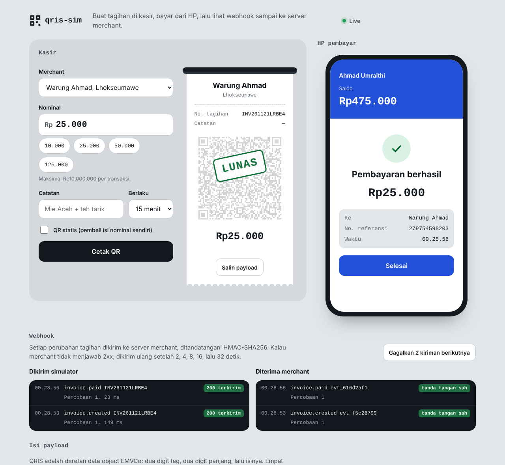
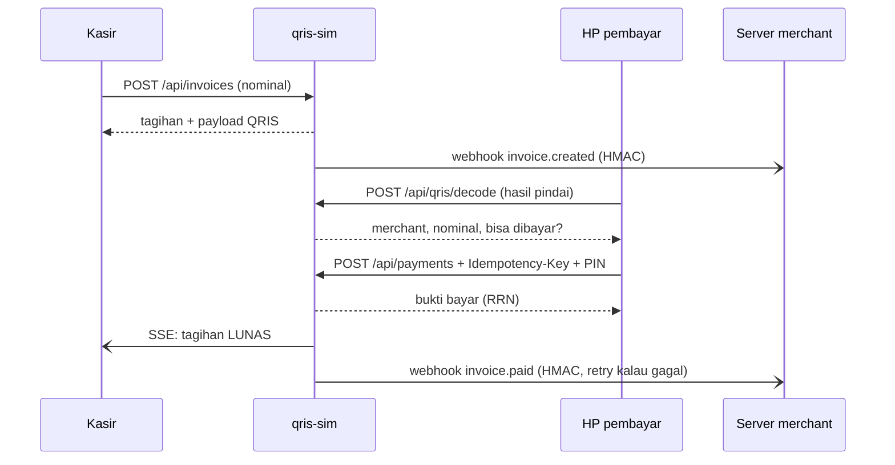

# qris-sim

[](https://github.com/KADAFERHIDUP/qris-sim/actions/workflows/ci.yml)


Simulator pembayaran QRIS dari sisi penyelenggara: membuat dan membaca payload EMVCo,
mengelola tagihan berbatas waktu, memproses pembayaran ber-PIN, lalu memberi tahu merchant
lewat webhook bertanda tangan HMAC.

Semuanya ditulis dengan Java 21 standar. Server HTTP, JSON, HMAC, dan stream live memakai
JDK saja, tanpa framework, supaya tiap bagian protokolnya kelihatan jelas.



> **Ini simulator.** Kode QR yang dibuat memakai penerbit `ID.QRISSIM.WWW`, bukan milik
> penyelenggara asli, jadi tidak bisa dibayar dengan aplikasi bank sungguhan, dan QR asli
> ditolak oleh simulator ini.

## Yang bisa dicoba

1. **Kasir** mencetak QR dinamis (nominal terkunci, berlaku 1–15 menit) atau QR statis
   (pembeli mengisi nominal).
2. **HP pembayar** memindai atau menempel payload, mengecek merchant, lalu membayar dengan PIN.
3. Struk di kasir langsung berubah **LUNAS** lewat Server-Sent Events, tanpa refresh.
4. **Log webhook** memperlihatkan event yang dikirim, tanda tangannya diverifikasi merchant,
   dan retry ketika merchant gagal menjawab (ada tombol untuk menggagalkannya).
5. **Isi payload** membongkar QR jadi tabel tag EMVCo beserta artinya.

## Yang dijaga

| Masalah di sistem pembayaran | Cara qris-sim menanganinya |
|---|---|
| QR diubah nominalnya | CRC16/CCITT-FALSE di tag 63 dicek; nominal QR dinamis juga dicocokkan dengan tagihan di server |
| Tombol bayar ditekan dua kali atau jaringan putus | Header `Idempotency-Key` wajib; permintaan ulang mengembalikan pembayaran yang sama |
| Dua pembayar berebut satu tagihan | Semua cek dan perubahan saldo jalan dalam satu kunci; diuji dengan 16 thread bersamaan |
| Tagihan dibayar setelah lewat waktu | Status hanya bisa berpindah dari MENUNGGU; tagihan lewat batas waktu ditutup otomatis |
| PIN ditebak | PIN disimpan sebagai hash PBKDF2; tiga kali salah mengunci dompet 5 menit |
| Webhook palsu atau diputar ulang | HMAC-SHA256 atas `timestamp.body`, dibandingkan dengan waktu konstan, salinan yang lebih dari 5 menit ditolak |
| Merchant sedang mati | Retry dengan jeda 2, 4, 8, 16, 32 detik; event id tetap sama supaya merchant bisa membuang duplikat |
| Nominal di luar aturan | Rp1 sampai Rp10.000.000 per transaksi, sesuai batas QRIS |
| Demo publik dipakai banyak orang | Dompet terpisah per pengunjung; penyimpanan tagihan, pembayaran, dan dompet dibatasi supaya memori tidak terus tumbuh |
| Banjir permintaan dari satu orang | Token bucket per IP untuk semua POST; kelebihannya dijawab 429 dengan header `Retry-After` |

## Alur



## Menjalankan

Dengan Docker:

```bash
docker build -t qris-sim .
docker run -p 8080:8080 qris-sim
```

Atau dengan Maven (Java 21):

```bash
mvn package
java -jar target/qris-sim.jar
```

Buka <http://localhost:8080>. Setiap browser otomatis mendapat dompet demo sendiri atas nama Ahmad Umraithi dengan saldo Rp500.000 dan PIN `123456`, jadi salah PIN di satu browser tidak mengunci pengunjung lain. Tombol **Isi ulang saldo** mengembalikan saldo dan membuka kunci PIN.

| Variabel | Default | Fungsi |
|---|---|---|
| `PORT` | `8080` | Port HTTP |
| `DEMO_PIN` | `123456` | PIN dompet demo |
| `WEBHOOK_SECRET` | acak saat start | Secret HMAC bersama merchant demo, minimal 16 karakter |
| `RATE_LIMIT_PER_MINUTE` | `60` | Batas permintaan POST per alamat IP per menit (lonjakan sampai setengahnya diizinkan) |

## API

Semua body JSON. Error selalu berbentuk `{"error": {"code": "...", "message": "..."}}`.

| Metode | Rute | Keterangan |
|---|---|---|
| `POST` | `/api/invoices` | Buat tagihan: `merchant_id`, `amount`, `note`, `ttl_seconds` |
| `GET` | `/api/invoices/{id}` | Status tagihan |
| `POST` | `/api/invoices/{id}/cancel` | Batalkan tagihan yang belum dibayar |
| `GET` | `/api/merchants/{id}/static-qr` | Payload QR statis |
| `POST` | `/api/qris/decode` | Baca payload, cek apakah bisa dibayar |
| `POST` | `/api/payments` | Bayar: `payload`, `wallet_id`, `pin`, `amount` (QR statis saja) + header `Idempotency-Key` |
| `POST` | `/api/wallets` | Buat dompet demo baru (saldo Rp500.000) |
| `GET` | `/api/wallets/{id}` | Saldo dan status kunci PIN |
| `POST` | `/api/wallets/{id}/reset` | Isi ulang saldo dan buka kunci PIN |
| `GET` | `/api/webhooks/deliveries` | 100 percobaan kirim webhook terakhir |
| `GET` | `/api/events` | Server-Sent Events: `payment` dan `webhook` |
| `GET`/`POST` | `/demo-merchant` | Status merchant demo; `{"fail_next": 2}` menggagalkan dua kiriman berikutnya |

Contoh:

```bash
# buat tagihan Rp32.000
curl -s localhost:8080/api/invoices -H 'Content-Type: application/json' \
  -d '{"merchant_id":"M001","amount":32000,"note":"Mie Aceh"}'

# bayar (ganti PAYLOAD dengan isi kolom payload di atas)
curl -s localhost:8080/api/payments -H 'Content-Type: application/json' \
  -H 'Idempotency-Key: 7b1f0c2e-bayar-1' \
  -d '{"payload":"PAYLOAD","wallet_id":"W001","pin":"123456"}'
```

### Memverifikasi webhook di sisi merchant

Header `X-QrisSim-Signature: t=1763661600,v1=<hex>` berisi HMAC-SHA256 dari
`"<t>.<body mentah>"` dengan secret bersama. Contoh di Node.js:

```js
const crypto = require('crypto');

function sah(header, rawBody, secret) {
  const { t, v1 } = Object.fromEntries(header.split(',').map((p) => p.split('=')));
  const expected = crypto.createHmac('sha256', secret).update(`${t}.${rawBody}`).digest('hex');
  const fresh = Math.abs(Date.now() / 1000 - Number(t)) <= 300;
  return fresh && crypto.timingSafeEqual(Buffer.from(expected), Buffer.from(v1));
}
```

## Struktur kode

```
src/main/java/id/my/kadaferhidup/qrissim/
├── qris/      Tlv, Crc16, QrisPayload, Merchant: format EMVCo MPM
├── core/      PaymentService, Invoice, Wallet, Payment: buku besar dan aturan bayar
├── webhook/   WebhookSigner, WebhookDispatcher: tanda tangan dan retry
├── json/      Json: penulis dan pembaca JSON kecil
├── http/      Api, EventHub (SSE), DemoMerchant, StaticFiles
└── App.java   merangkai semuanya dan menyalakan server
src/main/resources/web/   tampilan (HTML, CSS, JS tanpa framework)
```

## Test

```bash
mvn verify
```

72 test JUnit 5, mulai dari vektor uji CRC16 dan HMAC (RFC 4231), aturan status tagihan,
16 pembayar yang berebut satu tagihan, sampai server sungguhan yang dinyalakan di port acak
untuk menguji alur bayar, retry webhook, dan stream SSE. CI juga membangun image Docker
dan menunggu sampai container sehat.

## Lisensi

MIT. Gambar QR memakai [qrcode-generator](https://github.com/kazuhikoarase/qrcode-generator)
karya Kazuhiko Arase (MIT).

---

Dibuat oleh **Ahmad Umraithi**, Teknik Informatika Universitas Malikussaleh.
Proyek lain: [MiniBank](https://github.com/KADAFERHIDUP/minibank), core banking mini dengan Spring Boot.
